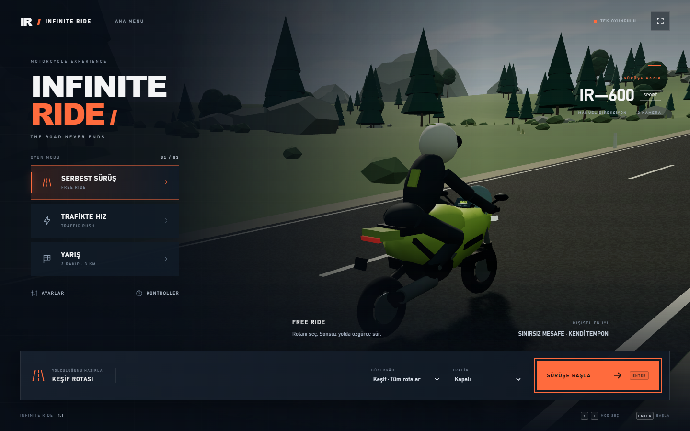

# INFINITE RIDE

**The Road Never Ends.**

Sonsuz yollarda motosiklet sürün, iki yönlü trafikte aralıkları değerlendirin veya yapay zekâ rakiplere karşı yarışın. INFINITE RIDE, dört farklı doğa ortamını üç oyun moduyla birleştiren, doğrudan tarayıcıda oynanabilen bağımsız bir 3D motosiklet oyunudur.

**[Hemen oynayın → INFINITE RIDE](https://emengin.github.io/infinite-ride/)**

Hesap, eklenti veya ek oyun kurulumu gerekmez. **Güncel sürüm: 1.1.1.**



## Sürüşe başlayın

1. Ana menüden **Serbest Sürüş**, **Trafikte Hız** veya **Yarış** modunu seçin.
2. Rotayı ve trafik yoğunluğunu belirleyip **SÜRÜŞE BAŞLA** düğmesine basın.
3. Hızlanmak için W veya ↑ tuşunu basılı tutun. Direksiyon manueldir; virajları A/D veya ←/→ ile alın.
4. Viraja girmeden önce yavaşlayın. Kamerayı C ile değiştirin; gerektiğinde R ile güvenle yola dönün.

## Üç farklı oyun modu

| Mod                             | Deneyim                                                                                                                                                                   |
| ------------------------------- | ------------------------------------------------------------------------------------------------------------------------------------------------------------------------- |
| **Free Ride — Serbest Sürüş**   | Süre ve skor baskısı olmadan sonsuz yolculuk. Biyom, trafik, kamera ve günün saati ayarlanabilir. Mola menüsünden sürüş özeti alınabilir.                                 |
| **Traffic Rush — Trafikte Hız** | Hız, mesafe, sollama ve yakın geçişlerle puan kazanın. Art arda başarılı hareketler combo çarpanını artırır. Çarpışma sürüşü bitirir; en iyi skor bu tarayıcıda saklanır. |
| **Race — Yarış**                | NOVA, ATLAS ve ECHO'ya karşı 3 km yarış. Geri sayım, üç kontrol noktası, canlı sıralama ve bitiş sonuçları bulunur. Yola dönme işlemi yarış süresine ceza ekler.          |

Trafik; sedan, hatchback, SUV, spor otomobil, kamyon, otobüs ve motosikletlerden oluşur. Araçlar takip mesafesine, yol eğriliğine ve uygun sollama boşluklarına tepki verir. Yarış rakipleri aynı yol yüzeyini ve sürüş fiziğini kullanır.

## Kontroller

| Girdi                    | İşlev                                      |
| ------------------------ | ------------------------------------------ |
| W / ↑                    | Gaz                                        |
| S / ↓                    | Fren                                       |
| A D / ← →                | Direksiyon                                 |
| Shift                    | Gazla birlikte nitro                       |
| C / V                    | Takip, kask ve geniş takip kamerası        |
| R                        | Mevcut güzergâhta güvenle sağ şeride dönme |
| Esc / duraklatma düğmesi | Mola / devam                               |
| Ana menüde ↑ / ↓, Enter  | Mod seçimi ve sürüşü başlatma              |
| F3                       | İsteğe bağlı performans göstergesi         |

Nitro kullanımda azalır; bırakıldığında yeniden dolar. Asfalt dışına çıkıldığında tutuş ve hızlanma azalır. Free Ride ve Race'te çarpışma sonrası yola dönülebilir; Traffic Rush'ta kaza sonuç ekranını açar.

Dokunmatik cihazlarda gaz, fren, yön, nitro ve kamera düğmeleri görünür. Gaz ve direksiyon aynı anda kullanılabilir; portre ve yatay yerleşim desteklenir. Pencere veya sekme odağı kaybolduğunda oyun duraklar ve basılı girdiler bırakılır. Tam ekran, destekleyen tarayıcılarda ana menüden açılabilir.

## Yollar ve atmosfer

- **Forest Road:** Orman kümeleri, yeşil arazi ve sisli uzaklıklar.
- **Coastal Road:** Deniz manzarası, kıyı kayalıkları ve açık ufuk.
- **Mountain Pass:** Kayalık yükseltiler, virajlar ve dağ tünelleri.
- **Highland Road:** Açık yaylalar, seyrek bitki örtüsü ve geniş görüş.

Keşif rotası ortamlar arasında yumuşak geçişler yapar. Dünya kodu aynı güzergâhın yeniden oluşturulmasını sağlar. Köprüler, tüneller, yol çizgileri, bariyerler ve uyarı işaretleri üretilen yolu takip eder.

Gün doğumu, gündüz, gün batımı, gece veya dinamik gün döngüsü seçilebilir. Gökyüzü, ışık, sis ve farlar atmosfere göre değişir. Kalite, çözünürlük ve trafik yoğunluğu farklı cihazlara göre ayarlanabilir.

## Kullanılan teknolojiler

| Teknoloji                               | Kullanım                                                             |
| --------------------------------------- | -------------------------------------------------------------------- |
| Three.js 0.187.0 ve WebGL 2             | Üç boyutlu dünya, motosiklet, trafik, ışık, gölge ve kameralar       |
| JavaScript ES modülleri                 | Oyun yaşam döngüsü, fizik, trafik yapay zekâsı ve modlar             |
| HTML5, CSS ve SVG                       | Türkçe arayüz, dijital göstergeler, menüler ve dokunmatik kontroller |
| 120 Hz sabit adımlı arcade fizik        | Gaz, fren, manuel direksiyon, yatış, yüzey teması ve nitro           |
| Seed tabanlı prosedürel üretim          | Tekrarlanabilir sonsuz yol, arazi ve biyom geçişleri                 |
| InstancedMesh, parça ve nesne havuzları | Çevre/araç çizimi ve kaynakların yeniden kullanılması                |
| Floating origin                         | Uzun sürüşlerde çizim koordinatlarının küçük tutulması               |
| Web Audio API                           | Hıza ve sürüş durumuna tepki veren motor, rüzgâr ve trafik sesleri   |
| localStorage                            | Bu tarayıcıdaki ayarlar ve kişisel rekorlar                          |
| Vite 8.3.8 ve Node.js                   | Geliştirme, üretim derlemesi ve otomatik testler                     |
| Playwright                              | Gerçek tarayıcıda oynanış, yerleşim ve güvenlik kontrolleri          |
| GitHub Actions ve Pages                 | Test edilen statik oyunun HTTPS üzerinden yayınlanması               |

Motosiklet, sürücü, trafik modelleri, çevre, dokular ve sesler kodla oluşturulur. Oyun çalışırken model, font, müzik, CDN veya harici yapay zekâ servisi indirilmez.

## Gizlilik ve güvenlik

Oyun hesap açmaz; ayarları veya skorları bir oyun sunucusuna göndermez. Tercihler ve rekorlar `localStorage` içinde bu tarayıcıda saklanır. Site verileri silinerek temizlenebilir; kayıtlar cihazlar arasında otomatik paylaşılmaz. Çevrimiçi skor tablosu bulunmaz.

Üretim sayfası dış bağlantıları ve yetkisiz betik yürütmeyi kısıtlayan bir içerik güvenliği politikası kullanır. Test kontrolü genel yayın adresinde açılmaz. Siteye bağlanırken GitHub Pages standart barındırma bilgilerini işleyebilir; oyun analiz veya reklam kodu çalıştırmaz.

Güvenlik bildirimleri için [SECURITY.md](SECURITY.md), sıradan hata bildirimleri için [Issues](https://github.com/emengin/infinite-ride/issues) kullanılabilir.

## Desteklenen deneyim

WebGL 2 destekli güncel bir tarayıcı ve donanım hızlandırma önerilir. Dokunmatik kontroller mevcut olsa da gerçek telefon performansı cihaz ve grafik ayarlarına bağlıdır. Fizik arcade türündedir; görseller stilizedir. Tam rijit cisim/ragdoll simülasyonu, çok şeritli otoyollar ve çevrimiçi çok oyunculu mod bu sürümde bulunmaz.

## Geliştirme ve yerel çalıştırma

Node.js **22.12+** gerekir; **24 LTS** önerilir.

```sh
npm ci
npm run dev
```

Üretim sürümü:

```sh
npm run build
npm run preview
```

Yerel önizleme `http://127.0.0.1:4173/` adresinde açılır. ES modülleri nedeniyle `index.html` doğrudan çift tıklamak yerine HTTP üzerinden sunulmalıdır. Derlenmiş `dist/` içeriği yerel bir sunucuda internet bağlantısı olmadan çalışabilir. Windows PowerShell `npm.ps1` dosyasını engelliyorsa komutlarda `npm.cmd` kullanılabilir.

### Doğrulama

```sh
npm test
npm audit
npx playwright install chromium
npm run build
npm run test:e2e
```

34 Node testi fizik, yol sürekliliği, biyomlar, trafik, çarpışmalar, modlar, kayıt, nitro ve atmosferi kapsar. Tarayıcı paketi oynanış, gerçek yarış bitişi, dokunma, ayarlar, ses, yaşam döngüsü, güvenlik ve Pages alt yolunu doğrular. `npm run test:soak` hızlandırılmış uzun sürüşü ayrıca denetler. Kapsam ve sınırlar [TEST_REPORT.md](TEST_REPORT.md) içinde belirtilmiştir.

### Kod yapısı ve yayın

`src/core` yaşam döngüsünü, `src/world` dünya üretimini, `src/motorcycle` modeli/fiziği, `src/traffic` trafiği, `src/modes` oyun modlarını, `src/rendering` sahne/kamerayı yönetir. `src/ui` arayüzü, `src/audio` sesi içerir. [Tasarım kapsamı](docs/PROJECT_BRIEF.md) ve [proje durumu](PROJECT_STATE.md) teknik kararları belgeler.

Vite `base: './'` kullanır; üretim dosyaları kökte veya bir alt klasörde çalışabilir. `main` değişiklikleri GitHub Actions tarafından denetlenir, derlenir, test edilir ve Pages'e yayınlanır. Test/derleme işi yayın yetkisi taşımaz; pull request'ler canlıya dağıtım yapmaz.

## Varlıklar ve lisanslar

Bağımlılıklar ve özgün içerikler [THIRD_PARTY_NOTICES.md](THIRD_PARTY_NOTICES.md) içinde açıklanmıştır. Three.js MIT, Vite MIT ve Playwright Apache-2.0 lisanslıdır. Proje kodu için ayrıca bir açık kaynak lisansı atanmış değildir.
